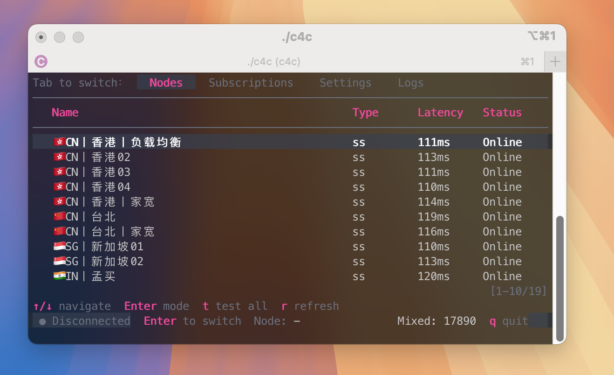

# 🚀 Clash for CLI

> 一个**无需 Root** 的终端代理管理器：订阅 ➜ 选节点 ➜ 一键启动本地代理（SOCKS5 + HTTP），再用 `c4cgo` 让任意命令走代理。

## 🌍 跨平台

当前支持：

- macOS（`amd64` Intel / `arm64` Apple Silicon）
- Linux（`amd64` x86_64 / `arm64` aarch64）

## 📦 Installation

### Build from source

```bash
make build
```

### From GitHub Releases


## 🛠️ Build

```bash
make build
```

## 🧭 使用

### `c4c`

启动：

```bash
./c4c
```

在终端界面里添加/选择订阅并选中节点即可连接（本地默认监听混合端口 `17890`，可在 Settings 里修改）。

说明：`c4c` 启动的 `mihomo` 默认以后台方式运行，**退出 `c4c` 不会自动停止代理核心**。如需停止，请在 Nodes 页按 `Enter` 切换到 `Disconnect`（或再次启动 `c4c` 后停止）。

默认**允许局域网连接**（监听 `0.0.0.0:17890`）。如需关闭，请编辑 `~/.clash4cli/config.yaml`：

```yaml
proxy:
  allow_lan: false
  bind_address: 127.0.0.1
```

提示：管理 API（`external-controller`）仅监听 `127.0.0.1`，并使用空闲端口（写入 `~/.clash4cli/proxy.lock`），不会对局域网开放。

### `c4cgo`

`c4cgo` 会读取 `~/.clash4cli/proxy.lock`，自动使用当前代理端口（有 `proxychains4` 时优先用它，否则回退到环境变量代理）。

示例：`curl` 走代理

```bash
./c4cgo curl ipinfo.io
```

示例输出：

```text
[c4cgo] Using proxy at 127.0.0.1:17890 (node: 🇸🇬SG丨新加坡02)
[c4cgo] Mode: proxychains4
[c4cgo] Proxy: socks5://127.0.0.1:17890
[c4cgo] Command: curl
─────────────────────────────────────
{
  "ip": "188.253.12.1",
  "city": "Singapore",
  "region": "Singapore",
  "country": "SG",
  "loc": "1.2897,103.8501",
  "org": "AS38136 Akari Networks",
  "postal": "018989",
  "timezone": "Asia/Singapore",
  "readme": "https://ipinfo.io/missingauth"
}
```

## 🗂️ 数据目录

默认：`~/.clash4cli/`（包含 `config.yaml`、`proxy.lock`、`subscriptions/`、`mihomo/` 等）。

## 📄 License

MIT（本项目源代码）。打包产物中可能包含第三方组件（如 `mihomo` / `proxychains-ng`），其许可证以 `THIRD_PARTY_NOTICES.md` 为准。
