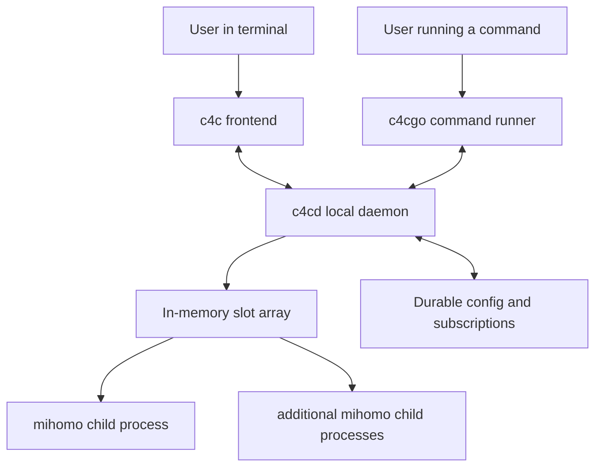

# Restructure Around c4cd as the Stateful Local Daemon

## Problem Frame

The current project is split across `c4c` and `c4cgo`, but the runtime authority still lives inside `c4c`. Today `c4c` directly creates and owns configuration, subscription, node, and slot managers, while `c4cgo` discovers live proxy state through lockfile-based coordination. Mihomo processes are intentionally detached so they survive frontend exit.

That structure makes the product harder to evolve in three important ways:
- It prevents `c4c` from becoming a true frontend over a stable backend boundary.
- It makes privileged runtime features awkward, because the TUI process itself becomes the place where root-sensitive behavior is decided.
- It keeps live runtime state half in memory and half on disk, which is useful for recovery today but works against a daemon-first design.

The desired direction is to make `c4cd` the single local backend process that owns both live control and durable application state, while `c4c` becomes its frontend client and `c4cgo` keeps its current role as the “run this command through the proxy” tool.

## Requirements

**Daemon Ownership and Roles**
- R1. Introduce `c4cd` as the authoritative local backend process for the application.
- R2. `c4cd` owns the live runtime state for slots, proxy modes, selected nodes, active mihomo processes, and other daemon-managed session state.
- R3. `c4cd` also owns durable application state changes for configuration, subscriptions, and related persisted data, so connected clients do not write competing local state independently.
- R4. `c4c` becomes a frontend client of `c4cd` rather than the process that directly owns runtime managers.
- R5. `c4cgo` keeps its current end-user purpose: running arbitrary commands through the proxy. In the new architecture it should cooperate with `c4cd` instead of treating lockfile state as the primary source of truth.
- R6. This redesign explicitly excludes `c4cweb` from the first phase. The architecture may leave room for future clients, but this work is only about `c4cd`, `c4c`, and `c4cgo`.

**API Boundary and Client Model**
- R7. `c4cd` exposes a local HTTP control API for first-party local clients.
- R8. The first version is local-only: the daemon listens on localhost HTTP and is intended for the same machine, not for remote or LAN control.
- R9. Within one local app environment, exactly one authoritative `c4cd` may exist at a time; starting a new daemon forcefully terminates the previous daemon instance before takeover.
- R10. Multiple `c4c` clients may connect to the authoritative `c4cd` at the same time.
- R11. In phase 1, any local process that can reach the localhost control surface is trusted to connect and write; the daemon does not add per-client authorization beyond localhost reachability.
- R12. Connected clients may all perform write operations; the daemon serializes them and the effective behavior is last-write-wins.
- R13. Clients should be able to observe a coherent shared state after any write, without needing frontend-specific recovery rules.

**Runtime State and Process Lifecycle**
- R14. `c4cd` maintains an in-memory slot array as the authoritative live model.
- R15. Each slot object tracks the state needed for control and visibility, including at least slot identity, selected subscription/node context, mode, exposed ports, mihomo PID, and runtime health.
- R16. Live slot runtime state is memory-authoritative and is not persisted to disk for daemon restart recovery.
- R17. Durable config and subscriptions remain persisted, but the currently running mihomo/session state does not need its own persistent restoration layer.
- R18. Mihomo processes started through `c4cd` are owned as children in the daemon’s process tree rather than deliberately detached from it.
- R19. If `c4cd` exits or is killed, all mihomo processes it started should terminate with it instead of remaining behind as orphaned long-lived runtime.
- R20. `c4cd` remains resident after the last `c4c` client disconnects, until the user explicitly stops it or the host lifecycle ends.

**Startup and User Experience**
- R21. For standard non-privileged use, starting `c4c` should automatically connect to an existing non-privileged `c4cd` or start one if needed.
- R22. The first version should preserve the current user experience of `c4c` and `c4cgo` as much as practical, even though the internal ownership model changes.
- R23. When the daemon is unavailable or unreachable, `c4c` should present clear connection/startup status rather than behaving like a standalone local runtime.
- R24. The redesign should avoid requiring users to manually think about `c4cd` for ordinary non-privileged workflows.

**Privilege Model**
- R25. Root-only capabilities such as TUN mode and Linux Docker hijack remain tied to the privilege level of the running `c4cd` process.
- R26. A non-privileged `c4cd` still supports ordinary local proxying, local control, and non-root workflows, but does not claim to provide root-only capabilities.
- R27. When a user requests a root-only feature, the system should guide them to manually start `c4cd` with `sudo` rather than trying to auto-elevate in the first phase.
- R28. The frontend experience should remain functionally consistent whether it is connected to a privileged or non-privileged daemon, aside from the availability of privileged features.

## Success Criteria
- Users can start `c4c` in the ordinary case without manually starting a daemon first.
- `c4c` behaves as a client of shared daemon state rather than as an isolated in-process runtime owner.
- `c4cgo` can still discover and use active proxy slots through the new daemon-centered architecture.
- Multiple `c4c` clients can connect simultaneously and see the same effective state.
- Killing `c4cd` causes all mihomo processes launched by it to terminate as well.
- Runtime slot/process state is no longer treated as something that must survive daemon death via disk-backed restoration.
- Users who need TUN or Docker hijack can obtain those capabilities by running `c4cd` with elevated privileges, without forcing sudo into the default workflow.

## Scope Boundaries
- No `c4cweb` work in this phase.
- No remote-control product surface, LAN exposure, or internet-accessible daemon mode in this phase.
- No automatic privilege escalation flow in this phase.
- No requirement to restore live daemon runtime state after `c4cd` is killed, exits, or the machine reboots.
- No requirement to redesign `c4cgo` into a general daemon-control CLI in this phase.

## Key Decisions
- **Daemon-first architecture**: `c4cd` becomes the single live authority so `c4c` can become a true frontend instead of a hidden runtime owner.
- **Local HTTP boundary**: The control protocol is explicitly local and HTTP-based in the first phase, which is enough to decouple clients without committing to remote control.
- **Memory-authoritative runtime**: Running slot state and mihomo process ownership live in daemon memory, not in a disk-backed runtime snapshot model.
- **Tree-shaped process lifecycle**: Mihomo should die with `c4cd`, which is the opposite of the current detached-runtime behavior and is intentional.
- **Privilege by daemon mode, not frontend mode**: Root-sensitive features are unlocked by how `c4cd` is launched, not by adding ad hoc privilege behavior into `c4c`.
- **Compatibility-first rollout**: The main command surfaces should feel familiar even though the internal architecture changes substantially.

## Dependencies / Assumptions
- Durable user configuration and subscription data continue to exist across runs.
- The first phase can retire the current assumption that live runtime state must be rediscoverable from disk after frontend exit.
- Planning will need to define how current lockfile-driven behavior transitions to daemon-owned coordination without creating split-brain state.

## Outstanding Questions

### Deferred to Planning
- [Affects R7][Technical] Exact daemon discovery mechanism for `c4c` and `c4cgo` while keeping the API local-only.
- [Affects R9][Technical] Whether the local HTTP API also supports push-style updates/events, or whether first phase clients can rely on request/refresh semantics.
- [Affects R16][Technical] Exact child-process strategy needed so mihomo reliably terminates with `c4cd` across supported OSes.
- [Affects R19][Technical] Exact auto-start behavior for non-privileged `c4cd`, including how `c4c` detects an already-running privileged daemon.
- [Affects R25][UX] How `c4c` explains the “manual sudo c4cd” path when the user enables TUN or Docker hijack.
- [Affects R20][Migration] Which visible `c4c`/`c4cgo` behaviors must stay byte-for-byte compatible in phase 1 versus which can shift slightly.

## Next Steps
→ `/ce:plan` for structured implementation planning
