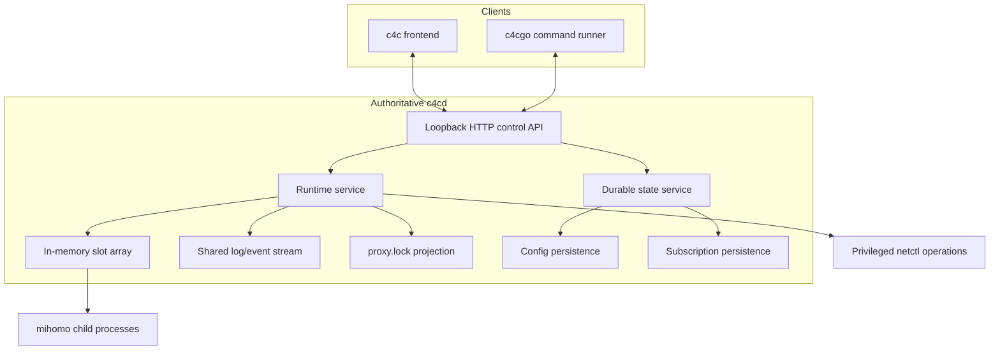
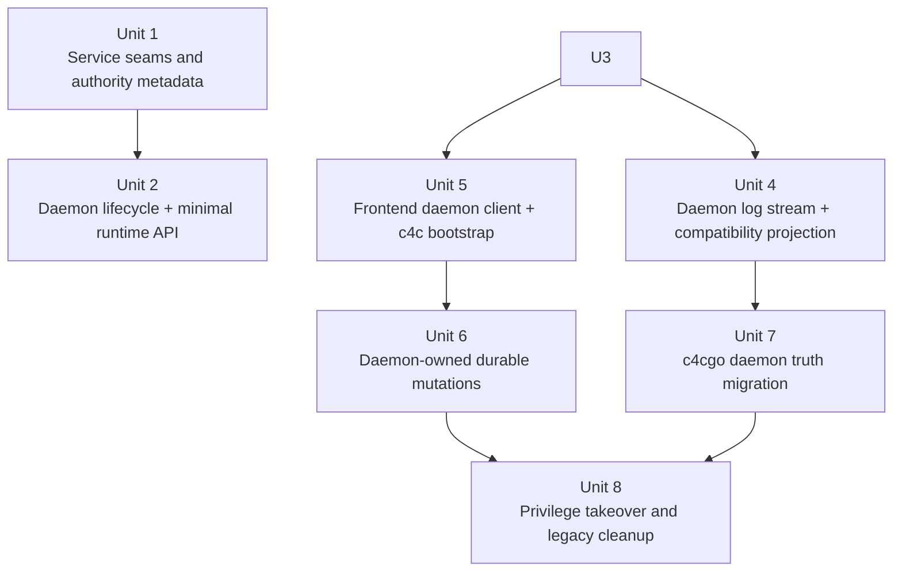
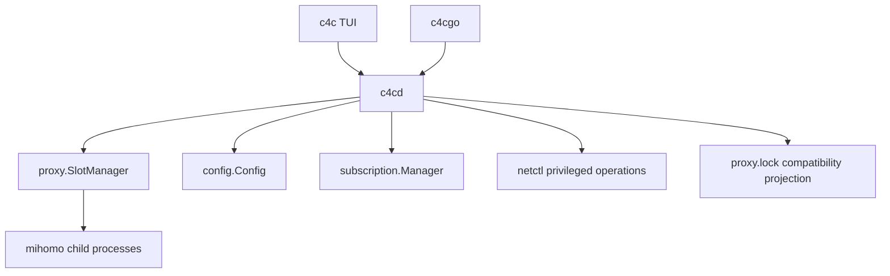

# refactor: Introduce c4cd daemon-first runtime

## Overview

This plan restructures the project so `c4cd` becomes the single authoritative local runtime, `c4c` becomes a frontend client, and `c4cgo` stops treating `proxy.lock` as the source of truth. The first phase keeps the product local-only, trusts loopback callers by design, preserves familiar `c4c`/`c4cgo` usage, and moves both live runtime state and durable state mutations behind the daemon boundary.

## Problem Frame

Today `c4c` directly owns config, subscription, node, and slot managers in-process, while `c4cgo` discovers runtime state through `proxy.lock`. Mihomo is deliberately detached so it can outlive the TUI. That model conflicts with the intended architecture in the origin document: one authoritative local backend, frontend clients over a stable control surface, in-memory runtime truth, and daemon-owned process lifecycle (see origin: `docs/brainstorms/2026-04-29-c4cd-daemon-first-architecture-requirements.md`).

The migration is cross-cutting because it changes:
- authority: `c4c` -> `c4cd`
- discovery: lockfile truth -> daemon truth
- lifecycle: detached mihomo -> daemon-owned child processes
- privilege model: `sudo c4c` hints -> manually started privileged `c4cd`
- frontend topology: single interactive TUI instance -> multiple concurrent frontend clients

## Requirements Trace

- R1-R6. Introduce `c4cd` as the authoritative backend and move `c4c`/`c4cgo` onto client roles.
- R7-R13. Provide a localhost HTTP control surface, enforce exactly one authoritative daemon, allow multiple connected clients, and keep phase-1 write semantics as serialized last-write-wins.
- R14-R20. Make daemon memory the runtime source of truth, keep mihomo in the daemon process tree, and keep the daemon resident after clients disconnect.
- R21-R24. Auto-connect or auto-start non-privileged `c4cd` from `c4c` and present clear connection state.
- R25-R28. Tie TUN/Docker hijack availability to daemon privilege mode and require manual `sudo c4cd` for privileged features.
- Success Criteria. Preserve ordinary `c4c`/`c4cgo` usability while eliminating detached-runtime and disk-restored runtime truth.

## Success Criteria

1. Users can start `c4c` in the ordinary case without manually starting a daemon first.
2. `c4c` behaves as a client of shared daemon state rather than as an isolated in-process runtime owner.
3. `c4cgo` can still discover and use active proxy slots through the new daemon-centered architecture.
4. Multiple `c4c` clients can connect simultaneously and see the same effective state.
5. Killing or replacing `c4cd` causes all mihomo processes launched by it to terminate as well.
6. Runtime slot/process state is no longer treated as something that must survive daemon death via disk-backed restoration.
7. Users who need TUN or Docker hijack can obtain those capabilities by running `c4cd` with elevated privileges, without forcing sudo into the default workflow.

## Scope Boundaries

- No `c4cweb` work in this plan.
- No remote/LAN daemon mode.
- No token, session, or per-client authorization layer in phase 1; loopback reachability is intentionally treated as trust.
- No requirement to preserve live slot runtime across daemon death or reboot.
- No requirement to redesign `c4cgo` into a general control CLI.
- No rollout to launchd/systemd service installation in this phase; daemon lifecycle is process-managed by the shipped binaries.

## Context & Research

### Relevant Code and Patterns

- `internal/app/app.go` currently assembles `config.Config`, `subscription.Manager`, `node.Manager`, and `proxy.SlotManager` directly inside `c4c`.
- `internal/app/instance_lock_unix.go` already contains a reusable pattern for PID-file-assisted flock ownership and force-kill takeover; the daemon version should reuse the force-kill idea but remove interactive prompting.
- `internal/proxy/slot_manager.go` is already the runtime core for slot state, log fan-out, traffic polling, lockfile projection, and start/stop/mode operations.
- `internal/proxy/controller.go` and `internal/proxy/process_unix.go` contain the current mihomo lifecycle behavior, including the detached-process assumption that must be reversed.
- `internal/proxy/lockfile.go` defines the current `proxy.lock` compatibility format; phase 1 should downgrade it from runtime truth to daemon-authored projection.
- `internal/tui/tui.go` currently restores runtime through `restoreStateFromProxyLock()` and uses in-process managers; this is the main frontend seam that must change.
- `cmd/c4cgo/main.go` currently reads `proxy.lock` and probes the resulting port; this is the main CLI seam that must change.
- `SPLIT.md` is useful prior art for interface extraction and daemon/client splitting, but it assumes Unix socket transport and lockfile recovery patterns that conflict with the finalized requirements.

### Institutional Learnings

- `docs/solutions/integration-issues/system-proxy-tun-integration-fixes-2026-04-26.md` shows that config changes only become trustworthy when they are paired with explicit runtime side effects and typed messages. The daemon plan should preserve that “state change -> runtime action” discipline instead of letting frontend disk writes imply runtime behavior.
- `docs/DOCKER_HIJACK.md` shows that root-only Docker redirect behavior currently depends on runtime port truth from `proxy.lock`; the daemon plan must replace that dependency with daemon-owned state before claiming authority.
- `docs/plans/2026-04-26-003-fix-tun-systemproxy-plan.md` reinforces that cleanup paths must be explicit, centralized, and cross-platform safe.

### External References

- Go `net/http` guidance supports loopback-only control servers with explicit shutdown, bounded timeouts, and `ErrServerClosed` handling.
- Go `os/exec`, `os/signal`, and Unix signal/process-group semantics reinforce that child ownership requires `Start -> Wait`, explicit signal escalation, and process-group-aware cleanup; a parent dying does not automatically guarantee children die in every failure mode.
- Local-only loopback control without per-client auth is viable for a single-user desktop tool, but only if the plan explicitly accepts the local-process trust model and never widens binding to `0.0.0.0` or follows proxy `AllowLan` settings.

## Key Technical Decisions

| Decision | Rationale |
|---|---|
| Use a loopback TCP control plane bound explicitly to `127.0.0.1`, not `AllowLan`, and not `0.0.0.0` | Matches the user’s “localhost HTTP, no token” decision while minimizing accidental LAN exposure (see origin: R7-R11). |
| Treat `proxy.lock` as a compatibility projection, not an authority source | `c4cgo`, Docker redirect, and any external tooling may still need a transition artifact, but runtime truth must live in daemon memory (see origin: R14-R17). |
| Keep exactly one authoritative daemon per resolved `CLASH4CLI_HOME` fingerprint and force-kill the previous daemon before takeover | Directly encodes the user’s single-authority decision while preventing cross-home accidental takeover and split-brain between normal and privileged daemons (see origin: R9). |
| Verify daemon identity before force-kill takeover | PID alone is too weak because of reuse and stale metadata windows; takeover must verify executable identity and daemon metadata before terminating a previous authority. |
| Move runtime state first, but front-load the minimum durable-write reroute needed to avoid mixed authority | Runtime ownership is the architectural pivot, but leaving frontend direct writes alive for too long would create an avoidable double-authority window for persistence. |
| Use polling/snapshot for shared state and SSE only for logs/events in phase 1 | This keeps the control plane simple while preserving current log-tab behavior without inventing a general event bus. |
| Remove the detached mihomo assumption and replace it with daemon-owned process-group cleanup plus startup orphan cleanup | This is required to satisfy the new lifecycle contract while remaining realistic about ungraceful exits and OS signal semantics. |
| Add explicit daemon API version reporting from day one | `c4c` and `c4cgo` become protocol clients in this architecture, so fast incompatibility detection is cheaper than ambiguous runtime failures. |
| Keep privileged capability switching manual (`sudo c4cd`) and make `c4c` reconnect around daemon replacement | Matches the user’s preference and limits phase-1 privilege complexity while still enabling TUN/Docker hijack. |
| If a privileged daemon already owns the home, non-privileged auto-start must not replace it | This prevents accidental downgrade of capability mode and preserves the user’s chosen authority level. |
| Extract client-facing interfaces/adapters instead of rewriting the TUI wholesale | Compatibility-first rollout is more realistic if the TUI migrates at stable seams rather than via a large UI rewrite. |

## Open Questions

### Resolved During Planning

- **Should normal and privileged daemons coexist?** No. There is exactly one authoritative `c4cd` per local app environment; replacement is the default rule, except non-privileged auto-start must not replace an already-running privileged authority.
- **Should phase 1 require token or peer-identity auth?** No. Loopback reachability is intentionally treated as trust in this phase, and that risk is explicitly accepted.
- **Should the daemon use file-backed runtime restoration after death?** No. Runtime slots and active mihomo ownership are memory-authoritative only.
- **Should `c4cgo` keep its current end-user role?** Yes. It remains the “run commands through the proxy” tool rather than becoming a broad daemon-control CLI.
- **Should `c4c` auto-start the daemon for ordinary use?** Yes, but only for non-privileged daemon mode.

### Deferred to Implementation

- **Exact default daemon port and whether it is configurable**: the plan fixes loopback TCP as the transport, but the final port constant/config hook can be chosen during implementation.
- **Exact daemon info file schema**: PID, port, version, privilege mode, and started-at are required; exact field names can be finalized while coding.
- **Exact API response model for write conflict visibility**: revision counters or monotonic runtime epochs should be included, but the precise response shape can be chosen during implementation.
- **Whether `proxy.lock` compatibility projection is removed in phase 2 or retained longer**: phase 1 keeps it as a daemon-authored projection; full removal timing can be decided after implementation confidence.

## High-Level Technical Design

> *This illustrates the intended approach and is directional guidance for review, not implementation specification. The implementing agent should treat it as context, not code to reproduce.*

The migration target is:
1. `c4cd` owns manager construction and all state mutation side effects.
2. `c4c` uses client/adaptor seams instead of local manager ownership.
3. `c4cgo` queries daemon runtime truth first.
4. `proxy.lock` becomes an output of daemon state rather than the place other components infer reality from.

## Implementation Units

- [ ] **Unit 1: Extract client-facing seams and authority metadata**

**Goal:** Introduce the interfaces, path helpers, and daemon identity artifacts needed to split authority cleanly without changing user-visible behavior yet.

**Requirements:** R1-R6, R9, R21-R24

**Dependencies:** None

**Files:**
- Create: `internal/proxy/slot_service.go`
- Create: `internal/daemon/meta.go`
- Create: `internal/daemon/meta_test.go`
- Modify: `internal/config/paths.go`
- Modify: `internal/app/instance_lock_unix.go`
- Modify: `internal/app/app.go`
- Test: `internal/app/instance_lock_test.go`

**Approach:**
- Extract a narrow runtime control interface from `proxy.SlotManager` so `c4c` can switch from in-process ownership to daemon-backed ownership without rewriting every tab.
- Introduce daemon metadata helpers for `daemon.lock`, `daemon.pid`, `daemon.info.json`, and daemon log paths under the existing home resolution rules in `internal/config/paths.go`.
- Reuse the existing flock + PID takeover pattern, but define a non-interactive daemon variant that can identify a prior owner, attempt graceful termination, and escalate to force-kill before a new daemon claims authority.
- Make authority identity stronger than PID alone by persisting and validating a home fingerprint plus daemon identity metadata before takeover.
- Treat the daemon identity tuple as a load-bearing contract for takeover: home fingerprint, executable identity, start time, privilege mode, and API version must be sufficient to reject wrong-process termination.
- Keep daemon metadata files atomic, owner-checked, and fail-closed on permission/ownership mismatch.
- Keep this unit intentionally behavior-preserving for `c4c` itself; it prepares the seam and authority metadata only.

**Execution note:** Add characterization coverage around the existing instance-lock takeover behavior before introducing the non-interactive daemon variant.

**Patterns to follow:**
- `internal/app/instance_lock_unix.go` for PID-file-assisted flock ownership and escalation timing
- `internal/config/paths.go` for `SUDO_USER`-aware home resolution

**Test scenarios:**
- Happy path — acquiring daemon authority metadata in a clean home creates lock/PID/info paths under the expected base directory.
- Edge case — stale PID/info files with no live process are cleaned up and do not block a fresh authority claim.
- Edge case — a daemon started under a different resolved home fingerprint is not treated as the same authority target.
- Error path — metadata files with unexpected ownership/permissions fail closed instead of being trusted for takeover.
- Error path — a live previous daemon that does not exit after SIGTERM is escalated to force-kill before takeover succeeds.
- Error path — if daemon metadata does not match the expected executable/home identity, takeover refuses to kill the process and fails closed.
- Error path — if the previous daemon cannot be killed, the new daemon authority claim fails rather than allowing dual authorities.
- Integration — root and non-root path resolution still point at the intended user home when `SUDO_USER` is present.

**Verification:**
- The repo has reusable daemon authority helpers and a slot control seam with no user-visible behavior change in `c4c`.

- [ ] **Unit 2: Ship `c4cd` in build, package, and install flows**

**Goal:** Ensure `c4cd` is produced, packaged, and installed anywhere later units expect it to exist.

**Requirements:** R1, R21-R24, Success Criteria 1

**Dependencies:** Unit 1

**Files:**
- Modify: `Makefile`
- Modify: `scripts/package_nfpm.sh`
- Modify: `.github/workflows/ci.yml`
- Modify: `.github/workflows/release.yml`
- Modify: `release.sh`
- Test: `Makefile` validation via existing build/test workflows

**Approach:**
- Extend the current build, package, install, uninstall, and release paths so `c4cd` ships alongside `c4c` and `c4cgo`.
- Treat this as a prerequisite for any auto-start or client/daemon migration work; later units must not assume an unshipped binary.
- Update packaging and release expectations before frontend or CLI code depends on daemon presence.

**Patterns to follow:**
- `Makefile` current `c4c`/`c4cgo` build and package targets
- `scripts/package_nfpm.sh` current package assembly path
- `.github/workflows/ci.yml` and `.github/workflows/release.yml` current build/release checks

**Test scenarios:**
- Happy path — normal local build produces `c4c`, `c4cgo`, and `c4cd` binaries.
- Happy path — cross-platform package output includes `c4cd` wherever `c4c`/`c4cgo` are shipped.
- Error path — release/build workflows fail if `c4cd` is missing from expected package artifacts.
- Integration — install and uninstall flows add and remove `c4cd` consistently with the other binaries.

**Verification:**
- Any supported install/release path that ships `c4c` also ships `c4cd`, so later units can rely on daemon presence.

- [ ] **Unit 3: Introduce `c4cd` as the authoritative runtime host**

**Goal:** Add the daemon binary runtime, minimal control API, and daemon-owned child-process lifecycle for live slot ownership.

**Requirements:** R1-R3, R7-R20, Success Criteria 1-6

**Dependencies:** Units 1 and 2

**Files:**
- Create: `cmd/c4cd/main.go`
- Create: `internal/daemon/server.go`
- Create: `internal/daemon/runtime_handlers.go`
- Create: `internal/daemon/types.go`
- Create: `internal/daemon/server_test.go`
- Create: `internal/daemon/lifecycle_test.go`
- Modify: `internal/proxy/slot_manager.go`
- Modify: `internal/proxy/controller.go`
- Modify: `internal/proxy/process_unix.go`
- Test: `internal/proxy/slot_manager_test.go`
- Test: `internal/proxy/slot_controller_test.go`

**Approach:**
- Construct `config.Config`, `subscription.Manager`, `node.Manager`, and `proxy.SlotManager` inside `c4cd`, making the daemon the runtime owner.
- Bind the control plane explicitly to loopback TCP and never couple daemon binding to proxy `AllowLan`.
- Expose a minimal HTTP API surface for health, runtime snapshot, slot commands, capability flags, API version, and daemon identity.
- Reverse the current detached process behavior: mihomo spawned by `c4cd` belongs to the daemon-owned lifecycle, with graceful termination, forced kill fallback, and startup orphan cleanup for dead prior daemon trees.
- Define the discovery contract in this unit: `daemon.info.json` is the canonical endpoint source for `c4c` and `c4cgo`, with deterministic stale-info cleanup.
- Apply minimum control-plane hardening within the accepted trust model: loopback-only bind, request method allowlists, body/header size limits, and explicit read/write/idle timeouts.

**Technical design:** *(directional guidance, not implementation specification)*
- Runtime reads should favor a small number of canonical endpoints: daemon health/capabilities, runtime snapshot, and per-slot mutations.
- The runtime snapshot should carry a monotonic revision/epoch so reconnecting clients can tell “new daemon, empty runtime” apart from “stale cached state.”
- Health/status responses should also carry daemon identity and API version so clients can reject incompatible or replaced authorities quickly.

**Patterns to follow:**
- `internal/proxy/slot_manager.go` as the current source of slot lifecycle operations
- `internal/proxy/process_unix.go` as the place to reverse detached child semantics into daemon-owned cleanup

**Test scenarios:**
- Happy path — starting `c4cd` exposes loopback health and runtime endpoints and reports zero active slots on first boot.
- Happy path — starting a slot through the daemon creates a runtime slot entry and exposes slot metadata.
- Edge case — a second daemon startup with the same home forcefully replaces the prior daemon and becomes the only authoritative instance.
- Edge case — startup with stale daemon metadata removes stale files and starts cleanly.
- Edge case — changing proxy `AllowLan` does not alter the daemon control-plane bind address.
- Error path — daemon startup aborts when the previous authority cannot be terminated.
- Error path — non-loopback access attempts fail because the daemon is only bound on loopback.
- Error path — malformed or oversized requests are rejected within the configured control-plane limits.
- Integration — daemon shutdown sends graceful termination to mihomo children, escalates if needed, and leaves no live child listeners behind.
- Integration — daemon restart after a killed prior daemon reports empty runtime slots while leaving durable config/subscriptions intact.

**Verification:**
- `c4cd` can start, own runtime state, serve the minimal runtime API, and shut down without leaving detached mihomo behind.

- [ ] **Unit 4: Add daemon log stream and compatibility projection**

**Goal:** Layer on log/event streaming and daemon-authored compatibility artifacts after the minimal runtime host is stable.

**Requirements:** R7-R13, R14-R17, Success Criteria 3-6

**Dependencies:** Unit 3

**Files:**
- Create: `internal/daemon/log_stream.go`
- Modify: `internal/daemon/server.go`
- Modify: `internal/proxy/lockfile.go`
- Modify: `internal/proxy/controller.go`
- Test: `internal/daemon/server_test.go`
- Test: `internal/proxy/lock_test.go`

**Approach:**
- Add daemon log/event streaming for frontend consumers after the base runtime API is stable.
- Continue writing `proxy.lock`, but only as a daemon-authored compatibility projection of current runtime state.
- Bound compatibility projection explicitly: it is output-only, includes daemon epoch/revision, and is rejected as authority by internal clients.
- Define projection freshness semantics so stale projection cannot be mistaken for current authority.

**Patterns to follow:**
- `internal/proxy/lockfile.go` for atomic file projection
- Existing log fan-out behavior in `internal/proxy/slot_manager.go`

**Test scenarios:**
- Happy path — daemon log stream emits current runtime log entries to connected clients.
- Happy path — daemon-authored `proxy.lock` projection reflects current runtime slots and daemon epoch.
- Edge case — projection is rebuilt correctly after daemon restart or stale-file cleanup.
- Error path — malformed or partially written compatibility projection files do not prevent the daemon from reconstructing fresh projection output.
- Integration — internal clients reject stale projection state as authority even when the file still exists.

**Verification:**
- Log streaming and compatibility projection exist as daemon-owned adjuncts, not as the source of runtime truth.

- [ ] **Unit 5: Switch `c4c` from runtime owner to daemon client**

**Goal:** Make `c4c` auto-connect/auto-start a non-privileged daemon and use daemon-backed runtime operations, log streaming, and reconnect semantics.

**Requirements:** R4-R6, R10-R13, R21-R24, Success Criteria 1-4

**Dependencies:** Units 3 and 4

**Files:**
- Create: `internal/daemon/client.go`
- Create: `internal/daemon/client_runtime_test.go`
- Create: `internal/daemon/spawn.go`
- Create: `internal/daemon/spawn_test.go`
- Modify: `internal/app/app.go`
- Modify: `cmd/c4c/main.go`
- Modify: `internal/tui/tui.go`
- Modify: `internal/tui/tabs/slots.go`
- Modify: `internal/tui/tabs/settings.go`
- Modify: `internal/tui/tabs/subscriptions.go`
- Test: `internal/tui/state_restore_test.go`
- Test: `internal/app/app_test.go`
- Test: `internal/tui/tabs/slots_test.go`

**Approach:**
- Add a daemon client implementation that satisfies the runtime seam introduced in Unit 1.
- Replace `c4c` startup-time runtime manager ownership with “connect to existing daemon or auto-start non-privileged daemon, then proceed.”
- Remove the current `c4c` single-instance assumption so multiple frontend clients can connect concurrently.
- Replace `restoreStateFromProxyLock()`-style runtime reconstruction with daemon snapshot bootstrap and reconnect-to-empty-runtime semantics.
- Keep shared-state freshness simple in phase 1: poll runtime snapshot for view state, use SSE only for log/event stream, and force full refresh after every successful mutation.
- Front-load the minimum durable-state write reroute needed so the frontend is not half-client, half-authoritative writer during this stage.

**Execution note:** Start with characterization coverage around current TUI boot/recovery behavior, then rewrite the bootstrap path against the daemon client.

**Patterns to follow:**
- `internal/tui/tui.go` for Bubble Tea message-driven state updates
- `internal/app/app.go` for startup warning and cleanup orchestration
- Existing periodic polling patterns in the TUI for traffic and logs

**Test scenarios:**
- Happy path — `c4c` with no daemon auto-starts a non-privileged daemon and enters the UI connected to it.
- Happy path — a second `c4c` instance connects to the same daemon without blocking on the old interactive single-instance lock.
- Edge case — if a privileged daemon already owns the home, `c4c` reconnects to it and does not auto-start a non-privileged replacement.
- Edge case — reconnect after daemon restart loads durable selections but shows zero running slots until a slot is started again.
- Edge case — runtime snapshot revision changes between requests trigger a refresh instead of leaving stale in-memory UI state.
- Error path — daemon auto-start failure surfaces a clear connection/startup error instead of entering a half-local UI mode.
- Error path — API version incompatibility between client and daemon fails fast with a clear compatibility message.
- Error path — daemon disconnect during an active session transitions the UI into reconnect/connection-warning state and recovers when the daemon returns.
- Integration — slot start/stop/mode actions issued from the TUI mutate daemon runtime rather than local in-process slot state.
- Integration — the Logs tab continues to receive daemon log lines through the remote stream rather than local slot-manager channels.

**Verification:**
- `c4c` no longer owns runtime managers directly and behaves as a daemon client in both cold-start and reconnect flows.

- [ ] **Unit 6: Move durable config and subscription mutations behind the daemon**

**Goal:** Ensure `c4cd`, not `c4c`, is the authoritative writer for config, slot refs, settings, and subscriptions.

**Requirements:** R2-R3, R21-R28, Success Criteria 2 and 6

**Dependencies:** Unit 5

**Files:**
- Create: `internal/daemon/state_handlers.go`
- Create: `internal/daemon/client_state.go`
- Create: `internal/daemon/client_state_test.go`
- Modify: `internal/config/config.go`
- Modify: `internal/subscription/manager.go`
- Modify: `internal/tui/tabs/settings.go`
- Modify: `internal/tui/tabs/subscriptions.go`
- Modify: `internal/tui/tabs/slots.go`
- Modify: `internal/tui/tui.go`
- Test: `internal/config/config_test.go`
- Test: `internal/subscription/manager_test.go`
- Test: `internal/tui/tabs/settings_test.go`
- Test: `internal/tui/tabs/subscriptions_test.go`

**Approach:**
- Introduce daemon-backed state endpoints and client adapters for the parts of config/subscription behavior the TUI actually consumes.
- Remove direct `cfg.Save()` and direct subscription persistence from frontend tabs; frontend changes become daemon commands, and daemon applies both persistence and required runtime side effects.
- Keep config/subscription managers on the daemon side as the durable source of truth.
- Preserve the existing “setting change -> runtime action” discipline from recent system-proxy/TUN learnings by letting the daemon own restart/apply/rollback side effects.
- Define a sensitive-data handling baseline for state endpoints, runtime snapshots, compatibility artifacts, and log/event output: redact subscription tokens, proxy credentials, and other secret-bearing fields by default.

**Patterns to follow:**
- `docs/solutions/integration-issues/system-proxy-tun-integration-fixes-2026-04-26.md`
- Existing config/subscription tests for expected persistence behavior
- `internal/tui/tabs/settings.go` and `internal/tui/tabs/subscriptions.go` as the current mutation call sites to reroute

**Test scenarios:**
- Happy path — changing a settings value through the TUI results in daemon-side persistence and the expected runtime side effect.
- Happy path — adding, updating, and deleting a subscription through the frontend changes daemon-owned durable state and is visible to a second connected frontend.
- Edge case — daemon restart preserves durable settings/subscriptions while runtime slots remain empty.
- Edge case — rapid consecutive settings updates serialize cleanly and result in one final persisted value.
- Error path — invalid config or subscription input is rejected by the daemon and surfaces a clear frontend error without partial local writes.
- Error path — daemon-side persistence failure does not leave frontend state pretending the mutation succeeded.
- Security path — runtime snapshots, state responses, and log/event output redact subscription tokens, proxy credentials, and other secret-bearing fields by default.
- Integration — changing system-proxy/TUN-related settings still drives the right runtime action path through daemon-owned netctl orchestration.

**Verification:**
- Frontend tabs no longer write durable state directly; all authoritative durable mutations happen inside `c4cd`.

- [ ] **Unit 7: Migrate `c4cgo` from lockfile truth to daemon truth**

**Goal:** Make `c4cgo` discover active runtime through `c4cd` first, while preserving its end-user role and failure clarity.

**Requirements:** R5, R7-R13, Success Criteria 1, 3, and 4

**Dependencies:** Units 3 and 4

**Files:**
- Modify: `cmd/c4cgo/main.go`
- Modify: `cmd/c4cgo/main_test.go`
- Modify: `internal/daemon/client.go`
- Modify: `internal/proxy/lockfile.go`
- Test: `cmd/c4cgo/find_proxychains_test.go`

**Approach:**
- Rework `c4cgo` discovery order to query `c4cd` runtime state first and treat daemon state as the authority.
- Preserve the existing user-facing command contract (`c4cgo curl ...`, slot selection, proxychains behavior) as closely as practical.
- Keep `proxy.lock` only as a compatibility projection for external observers; do not treat it as runtime authority inside `c4cgo` anymore.
- On daemon unavailability, fail clearly instead of silently reviving file-backed truth assumptions.
- Require `c4cgo` to fail closed on daemon/API version mismatch rather than guessing behavior from stale compatibility artifacts.

**Execution note:** Add characterization coverage for today’s slot-selection and error-message behavior before switching discovery to daemon APIs.

**Patterns to follow:**
- `cmd/c4cgo/main.go` current argument parsing and slot-selection flow
- `internal/proxy/lockfile.go` for compatibility output expectations during transition

**Test scenarios:**
- Happy path — `c4cgo` with no explicit slot selects the same effective active slot that the daemon reports as authoritative.
- Happy path — `c4cgo -s N` uses the requested active slot when the daemon reports it running.
- Edge case — multiple active slots still preserve current slot-selection semantics unless explicitly changed.
- Error path — daemon unreachable produces a clear “daemon not running/unreachable” message rather than a misleading lockfile error.
- Error path — API version incompatibility between `c4cgo` and daemon fails fast and does not fall back to `proxy.lock` as runtime truth.
- Error path — requested slot absent in daemon runtime returns a deterministic error and does not attempt command execution.
- Integration — daemon-reported proxy host/port are used consistently for proxychains/env mode execution.

**Verification:**
- `c4cgo` continues to feel the same to users while taking runtime truth from the daemon rather than from `proxy.lock`.

- [ ] **Unit 8: Privileged takeover, legacy cleanup, and rollout hardening**

**Goal:** Finalize the normal-vs-privileged daemon handoff, remove legacy assumptions that conflict with daemon-first behavior, and harden the plan for rollout.

**Requirements:** R9, R16-R28, Success Criteria 4-7

**Dependencies:** Units 5, 6, and 7

**Files:**
- Modify: `cmd/c4cd/main.go`
- Modify: `internal/daemon/server.go`
- Modify: `internal/daemon/spawn.go`
- Modify: `internal/app/app.go`
- Modify: `internal/tui/tabs/settings.go`
- Modify: `internal/tui/tui.go`
- Modify: `internal/proxy/process_unix.go`
- Modify: `internal/proxy/controller.go`
- Modify: `internal/tui/state_restore_test.go`
- Test: `internal/daemon/lifecycle_test.go`
- Test: `internal/tui/tabs/settings_test.go`
- Test: `internal/proxy/controller_traffic_test.go`

**Approach:**
- Implement the user-intended takeover path: manual `sudo c4cd` startup forcefully replaces the non-privileged daemon, becomes the only authority, and causes connected frontends to reconnect around the replacement.
- Make daemon capability flags explicit so the frontend can say “connected, but non-privileged” versus “connected, privileged.”
- Remove or reduce remaining lockfile-restoration and detached-process assumptions that would otherwise reintroduce split truth.
- Harden shutdown/startup cleanup so normal daemon replacement, explicit stop, and crash recovery do not leave stale authority artifacts behind.
- Enforce the priority rule that an already-running privileged daemon is never downgraded by non-privileged auto-start behavior.
- Add a takeover quiesce boundary: the old daemon must stop accepting new mutations, flush durable writes, and hand off a final revision watermark before normal replacement; forced termination remains the timeout fallback, not the first transition.

**Patterns to follow:**
- `internal/app/app.go` existing startup-warning path for root-sensitive features
- `internal/proxy/process_unix.go` lifecycle utilities after they are updated for daemon-owned cleanup
- `docs/DOCKER_HIJACK.md` for privileged network-side expectations

**Test scenarios:**
- Happy path — a manually started privileged daemon replaces a running non-privileged daemon and exposes privileged capability flags to reconnecting frontends.
- Edge case — connected frontends survive daemon replacement by reconnecting to the new authority and refreshing their snapshots.
- Edge case — a non-privileged `c4c` startup sees an existing privileged daemon, reconnects to it, and does not auto-start a downgraded replacement.
- Edge case — daemon startup after an unclean prior exit clears stale authority artifacts and does not report fake running slots.
- Error path — privileged takeover failure leaves the previous daemon untouched and returns a clear failure reason.
- Error path — a frontend connected to a non-privileged daemon receives a clear capability-limited response when requesting TUN/Docker hijack behavior.
- Integration — normal daemon replacement quiesces writes, flushes durable changes, and reconnects clients without acknowledging writes that are lost in handoff.
- Integration — system-proxy/TUN/Docker-hijack settings drive capability-aware daemon behavior without pretending success when connected to a non-privileged daemon.

**Verification:**
- The repo no longer depends on detached runtime survival or lockfile-based runtime restoration for normal operation, and privileged takeover works within the accepted phase-1 trust model.

## System-Wide Impact

- **Interaction graph:** `c4c`, `c4cgo`, `c4cd`, `internal/proxy`, `internal/config`, `internal/subscription`, and `internal/netctl` all move from loosely coordinated local calls/files to a single daemon-owned command path.
- **Error propagation:** daemon authority/discovery failures should surface as connection/startup errors in `c4c`/`c4cgo`; runtime operation failures should remain slot-scoped when possible; privileged capability denials should not masquerade as generic connectivity issues.
- **State lifecycle risks:** the highest-risk transitions are daemon takeover, daemon crash recovery, reconnect into empty runtime, and compatibility projection drift.
- **API surface parity:** `c4c` and `c4cgo` must both reflect daemon runtime truth; slot operations, capability visibility, and startup error language must remain aligned across both interfaces.
- **Integration coverage:** unit tests alone will not prove takeover, reconnect, child cleanup, and compatibility projection. These require daemon/client integration tests around process lifecycle and state transitions.
- **Unchanged invariants:** slot mixed-port behavior, node selection semantics, proxychains/env execution modes, and the durable config/subscription formats remain conceptually the same; the plan changes where truth lives, not the core product concepts those features express.

## Risks & Dependencies

| Risk | Mitigation |
|------|------------|
| Dual-authority split-brain during startup or sudo takeover | Reuse flock/PID authority logic, require forceful prior-daemon termination before bind, verify daemon identity before kill, and fail startup rather than allowing a second authority |
| Mihomo children survive daemon death | Replace detached process behavior, add daemon-owned shutdown + startup orphan cleanup, and test both graceful and unclean exit paths |
| Frontend regressions from removing lockfile restore | Add characterization coverage first, bootstrap from daemon snapshots, and explicitly model “connected but zero runtime slots” UI states |
| Durable writes still happening in the frontend | Reroute every `cfg.Save()` and subscription persistence call behind daemon commands before claiming phase-1 completion |
| `c4cgo` behavior drift | Characterize current slot selection and error messaging, preserve the contract while changing runtime discovery, and fail closed on daemon/API mismatch |
| Localhost trust model is broader than typical local desktop security expectations | Hard-code loopback-only binding, enforce method/body/timeout limits, keep the trust acceptance explicit in docs/plan, and avoid coupling the daemon surface to `AllowLan` |
| Privileged takeover confuses users | Expose capability flags, clear reconnect messaging, dedicated privileged-path test coverage, and a strict “no non-privileged downgrade” rule |

## Dependencies / Prerequisites

- A shared daemon metadata format under the existing `CLASH4CLI_HOME` path model.
- Agreement that phase 1 accepts loopback-only trust without token auth.
- Existing slot/config/subscription tests used as characterization constraints before the main migration.

## Phased Delivery

### Phase 1
- Units 1-6: establish seams, ship `c4cd`, add the daemon runtime/API, add compatibility projection/log streaming, make `c4c` a runtime client, and move durable mutations behind the daemon so phase-1 authority is coherent.

### Phase 2
- Unit 7: migrate `c4cgo` to daemon truth and bound any temporary compatibility-only fallback semantics.

### Phase 3
- Unit 8: finalize privileged takeover semantics, remove legacy assumptions, and harden rollout.

## Documentation / Operational Notes

- Update command help and user-facing docs to explain that ordinary `c4c` use auto-starts or auto-connects to `c4cd`, while privileged features require manual `sudo c4cd`.
- Document the accepted phase-1 local trust model plainly: loopback-only, no token, no remote exposure, and any local process that can reach loopback may issue control writes.
- Document the minimum control-plane limits that still apply inside that trusted model: method allowlists, request size/time bounds, and no daemon bind widening through `AllowLan`.
- Update any docs that currently imply `proxy.lock` is the runtime truth, especially `c4cgo`-related guidance and Docker hijack documentation.
- Preserve rollback clarity: if daemon rollout is partially reverted, `proxy.lock` semantics and detached-process behavior cannot be left half-migrated.

## Sources & References

- **Origin document:** `docs/brainstorms/2026-04-29-c4cd-daemon-first-architecture-requirements.md`
- Prior art: `SPLIT.md`
- Relevant code: `Makefile`, `release.sh`, `scripts/package_nfpm.sh`, `.github/workflows/ci.yml`, `.github/workflows/release.yml`, `internal/app/app.go`, `internal/app/instance_lock_unix.go`, `internal/proxy/slot_manager.go`, `internal/proxy/controller.go`, `internal/proxy/process_unix.go`, `internal/proxy/lockfile.go`, `internal/tui/tui.go`, `cmd/c4cgo/main.go`
- Institutional learnings: `docs/solutions/integration-issues/system-proxy-tun-integration-fixes-2026-04-26.md`, `docs/DOCKER_HIJACK.md`, `docs/plans/2026-04-26-003-fix-tun-systemproxy-plan.md`
- External docs: https://pkg.go.dev/net/http, https://pkg.go.dev/os/exec, https://pkg.go.dev/os/signal, https://man7.org/linux/man-pages/man2/kill.2.html, https://man7.org/linux/man-pages/man2/waitpid.2.html, https://man7.org/linux/man-pages/man7/signal.7.html, https://man7.org/linux/man-pages/man7/capabilities.7.html
