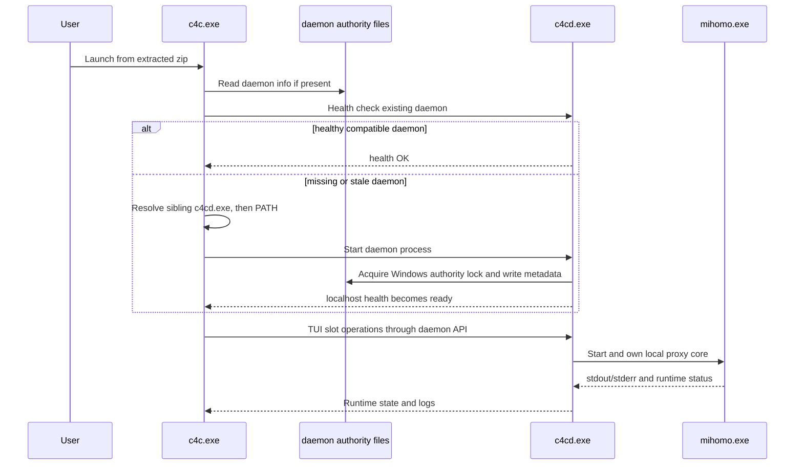
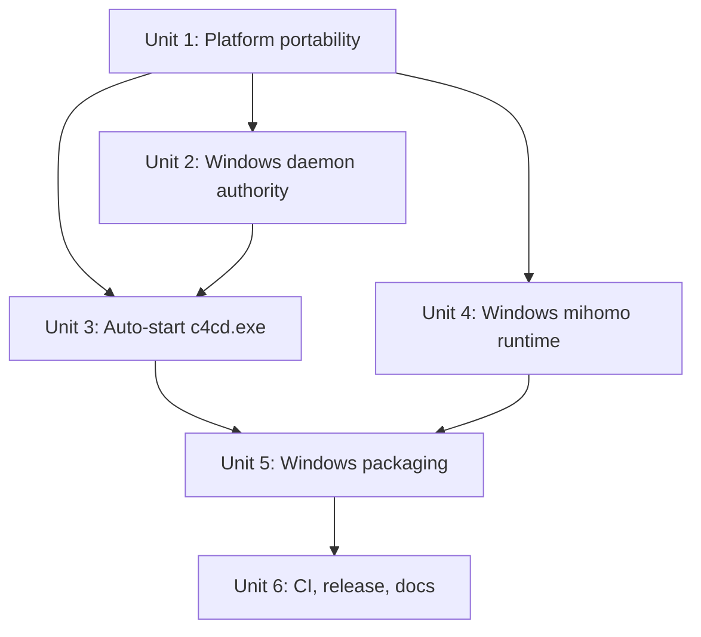
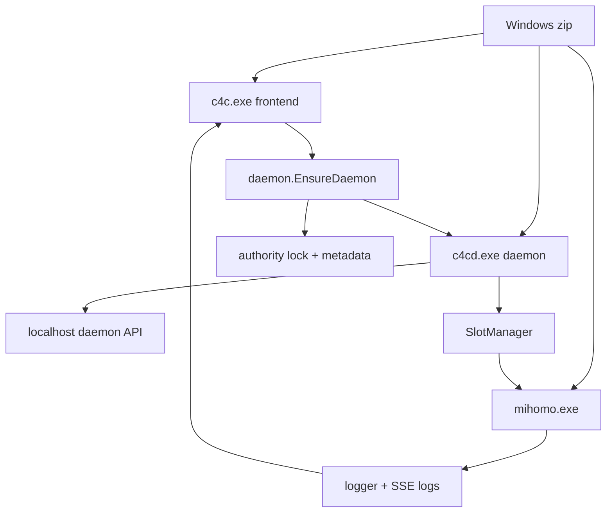

# feat: Add Windows MVP support

## Overview

Add a bounded Windows MVP for clash4cli centered on the daemon-first architecture: a Windows release zip for `windows/amd64` and `windows/arm64` contains `c4c.exe`, `c4cd.exe`, and `mihomo.exe`; running `c4c.exe` automatically connects to or starts the local `c4cd.exe`; `c4cd.exe` owns local mihomo runtime state through the existing localhost daemon API.

This MVP is intentionally narrower than macOS/Linux parity. It does not ship `c4cgo.exe`, does not provide proxychains-style transparent command proxying, and does not support Windows system proxy, TUN, or Docker redirect behavior in the first version.

| Surface | Windows MVP behavior | Out of scope |
|---|---|---|
| Runtime ownership | `c4cd.exe` owns slots and mihomo processes | Standalone `c4c.exe` runtime ownership |
| Distribution | GitHub Release zip for amd64 and arm64 | npm Windows packages in this phase |
| User startup | `c4c.exe` auto-starts sibling `c4cd.exe`, then PATH fallback | Requiring users to manually start daemon |
| Proxy use | Local mihomo HTTP/SOCKS/mixed proxy ports | `c4cgo`, proxychains, system proxy, TUN, Docker redirect |
| Stop UX | No new explicit stop command in this MVP | `c4cd --stop` or TUI daemon stop action |

## Problem Frame

The project already moved toward a daemon-first model where `c4cd` is the authoritative local backend, while `c4c` is the frontend client and `c4cgo` cooperates with daemon runtime state (see origin: `docs/brainstorms/2026-04-29-c4cd-daemon-first-architecture-requirements.md`). Today, the repository and release pipeline are macOS/Linux-only: Make targets, dependency fetching, CI, release upload patterns, and Unix-specific process/lock helpers do not yet support Windows.

The user goal for this plan is not full Windows parity. The target is an installable, runnable Windows MVP: unzip, launch `c4c.exe`, auto-start `c4cd.exe`, connect to localhost daemon API, and run mihomo as the local proxy core.

## Requirements Trace

- R1. Produce Windows Release zip artifacts for `windows/amd64` and `windows/arm64`.
- R2. Each Windows zip contains the required runtime files: `c4c.exe`, `c4cd.exe`, `mihomo.exe`, `VERSION`, `LICENSE`, and `LICENSE.mihomo` when the mihomo license notice is available.
- R3. Running `c4c.exe` on Windows automatically connects to an existing healthy daemon or starts `c4cd.exe` from the same directory, with PATH fallback.
- R4. `c4cd.exe` remains the single local runtime authority for slots, selected nodes, active mihomo processes, and daemon-owned state (see origin: `docs/brainstorms/2026-04-29-c4cd-daemon-first-architecture-requirements.md`).
- R5. Windows MVP supports ordinary local proxying through mihomo-managed local ports, not privileged or system-wide network changes.
- R6. Windows MVP does not ship or enable `c4cgo.exe`, proxychains, system proxy, TUN, or Docker redirect.
- R7. CI verifies Windows buildability and package contents for both target architectures.
- R8. Windows-specific platform behavior does not regress existing macOS/Linux daemon-first behavior.

## Scope Boundaries

- No Windows `c4cgo.exe` distribution or env/proxychains substitute in this MVP.
- No Windows npm package changes in this MVP unless a later plan extends distribution beyond GitHub zip.
- No Windows system proxy, WinHTTP/WinINET registry changes, TUN/Wintun, admin elevation flow, or Docker redirect.
- No new explicit daemon stop UX in this MVP. Exiting `c4c.exe` continues to leave `c4cd.exe` resident, matching daemon-first intent; documentation should explain this limitation.
- No remote/LAN daemon control. The daemon remains localhost-only.
- No automatic replacement of an executable-mismatched or incompatible old daemon in the Windows MVP. If an existing daemon is healthy and API-compatible, `c4c.exe` may connect to it; if it is incompatible or unsafe to identify, startup should fail clearly and document manual recovery.

## Context & Research

### Relevant Code and Patterns

- `internal/app/app.go` already starts the frontend by calling `daemon.EnsureDaemon`, then uses `newDaemonSlotService` to route TUI slot operations through the daemon.
- `internal/daemon/spawn.go` contains current daemon discovery and auto-start logic, but sibling discovery is hardcoded to `c4cd` rather than `c4cd.exe`.
- `internal/daemon/server.go` owns the localhost HTTP server, authority metadata, lock acquisition, log publisher setup, and `SlotManager` lifecycle.
- `internal/daemon/authority_lock_unix.go` provides Unix authority locking through `flock`; Windows needs an equivalent implementation.
- `internal/daemon/meta.go`, `internal/daemon/server.go`, `internal/daemon/spawn.go`, `internal/app/app.go`, `internal/config/paths.go`, and `internal/tui/tabs/settings.go` contain Unix privilege assumptions through `os.Geteuid`.
- `internal/proxy/process_unix.go` implements Unix process liveness, termination, stale port cleanup, and mihomo process command checks; `internal/proxy/process_other.go` is currently a non-functional stub for Windows.
- `internal/proxy/controller.go` already has partial Windows-aware mihomo naming through `mihomo-windows-<arch>.exe`, but discovery and packaging are incomplete.
- `internal/proxy/testhooks.go` already exposes test hooks for mihomo discovery, process spawning, and subprocess detachment.
- `Makefile`, `pull_deps.sh`, `scripts/fetch_mihomo.sh`, `.github/workflows/ci.yml`, `.github/workflows/release.yml`, and `release.sh` define the current darwin/linux dependency and release matrix.
- `cmd/c4cd/main.go` uses Unix signal constants directly and should move signal-context behavior behind platform-aware helpers.

### Institutional Learnings

- `docs/solutions/integration-issues/mihomo-logs-absent-sse-stream-2026-05-05.md` warns that daemon-owned mihomo output must flow through pipes into the unified logger/SSE stream, not only to files, and that streaming clients must not inherit short global request timeouts.
- `docs/solutions/integration-issues/daemon-slot-service-constructor-skip-2026-05-03.md` shows that bypassing daemon adapter constructors can silently break TUI runtime control and logs; Windows startup must preserve the `c4c -> c4cd -> daemonSlotService -> SSE logs` wiring.
- `docs/solutions/integration-issues/system-proxy-tun-integration-fixes-2026-04-26.md` shows unsupported-platform paths should be safe no-ops or explicit unsupported states, especially in shared cleanup paths.
- `docs/solutions/ui-bugs/node-browser-fullscreen-title-visibility-q-quit-2026-05-05.md`, `docs/solutions/ui-bugs/nodebrowser-table-overflow-many-nodes-2026-05-04.md`, and `docs/solutions/ui-bugs/slot-card-border-overflow-2026-04-08.md` are relevant for Windows terminal smoke testing, especially small windows, bright themes, and width calculations.

### External References

- Go `os` and `os/exec` documentation: Windows process lookup and process signaling differ from Unix; `exec.Command` should be used without shell command strings.
- Go `os/signal` documentation: Windows supports `os.Interrupt` semantics differently from Unix `SIGTERM`/`SIGKILL`.
- `golang.org/x/sys/windows` documentation: provides Windows APIs such as `LockFileEx`, `UnlockFileEx`, `OpenProcess`, `GetExitCodeProcess`, and `TerminateProcess` through the existing dependency family.
- Microsoft `LockFileEx`, `GetExitCodeProcess`, `TerminateProcess`, and process termination guidance: Windows file locking and process termination must not be modeled as Unix `flock` and signals.
- GitHub Actions Go and matrix documentation: Windows architecture builds and package artifact verification should be explicit matrix entries.
- PowerShell `Compress-Archive` or Go `archive/zip` documentation: Windows release artifacts should be zip archives with relative paths only.

## Key Technical Decisions

- Use Windows zip as the first distribution surface: this matches the user decision and avoids npm package matrix work in the MVP.
- Include `c4c.exe` and `c4cd.exe`, but not `c4cgo.exe`: daemon-first requires `c4cd`, while `c4cgo`'s proxychains safety model is Unix-specific and would mislead Windows users.
- Resolve daemon binary sibling-first, then PATH fallback: sibling discovery supports unzip-and-run; PATH fallback preserves developer/operator flexibility.
- Keep daemon API localhost-only: this preserves existing trust boundaries from daemon-first requirements and avoids introducing remote auth concerns.
- Treat Windows privileged/system networking features as unsupported regardless of Administrator status: the MVP excludes system proxy, TUN, and Docker redirect, so Windows admin detection should not imply extra capability.
- Use package-local Windows implementations instead of a broad cross-repository platform framework: keep `flock`, Unix signals, and Unix process liveness intact for macOS/Linux while adding only the Windows helpers needed by daemon startup, authority locking, and packaging.
- Prefer file-lock parity for daemon authority over a larger mutex redesign: `LockFileEx` maps closely to the existing lock-file model and keeps metadata paths unchanged.
- Preserve fixed daemon port behavior for the MVP: if `127.0.0.1:47189` is occupied by a non-daemon process, fail clearly rather than introducing dynamic port discovery in this plan.
- Preserve daemon-first residency: exiting `c4c.exe` does not stop `c4cd.exe`; explicit stop UX is deferred by user decision.
- Preserve safe old-daemon behavior: connect to a healthy API-compatible daemon; otherwise fail clearly rather than forcefully replacing an executable-mismatched daemon in the Windows MVP.

## Open Questions

### Resolved During Planning

- Which Windows architectures are in scope? `windows/amd64` and `windows/arm64`.
- What is the primary Windows distribution mechanism? GitHub Release zip.
- Should Windows include `c4cgo`? No; `c4cgo.exe` is excluded from Windows MVP artifacts.
- Should Windows include `c4cd`? Yes; without `c4cd.exe`, daemon-first Windows startup cannot run.
- Should `c4c.exe` auto-start the daemon? Yes; sibling `c4cd.exe` first, PATH fallback second.
- Should Windows MVP support system proxy/TUN/Docker redirect? No; local proxy ports only.
- Should the first MVP add explicit daemon stop UX? No; document the resident daemon behavior instead.
- How should `mihomo.exe` enter the Windows zip? Extend the existing predownload chain through `scripts/fetch_mihomo.sh` and package from `third_party/mihomo`.

### Deferred to Implementation

- Exact helper names and locations for package-local platform functions: defer to implementation so naming can follow the smallest viable package boundaries.
- Whether future Windows hard-kill cleanup should use Job Objects: the MVP only requires normal daemon shutdown and slot stop paths to stop mihomo; child-tree cleanup after external `c4cd.exe` termination is a documented limitation unless a minimal implementation falls out naturally.
- Exact zip creation mechanism: PowerShell `Compress-Archive`, Go `archive/zip`, or a small repository script are acceptable if they produce deterministic relative-path zip contents and integrate cleanly with Make/GitHub Actions.
- Exact user-facing wording for unsupported Windows features and daemon-residency documentation: defer to documentation editing, but the behavior must be clear.

## High-Level Technical Design

> *This illustrates the intended approach and is directional guidance for review, not implementation specification. The implementing agent should treat it as context, not code to reproduce.*

## Implementation Units

- [ ] **Unit 1: Isolate Windows portability blockers**

**Goal:** Make the shared codebase compile and reason correctly on Windows by isolating privilege checks, executable suffix handling, and signal context behind small package-local helpers.

**Requirements:** R3, R5, R6, R8

**Dependencies:** None

**Files:**
- Modify: `internal/app/app.go`
- Modify: `internal/config/paths.go`
- Modify: `internal/daemon/meta.go`
- Modify: `internal/daemon/server.go`
- Modify: `internal/daemon/spawn.go`
- Modify: `internal/tui/tabs/settings.go`
- Create: package-local helper files as needed under `internal/config/`, `internal/daemon/`, and `cmd/c4cd/`
- Test: `internal/daemon/meta_test.go`
- Test: `internal/daemon/spawn_test.go`
- Test: `internal/config/paths_test.go` if privilege-path behavior needs coverage

**Approach:**
- Replace direct Unix privilege assumptions in shared files with the smallest local helper needed by that package. Unix behavior should remain equivalent to the current `os.Geteuid` checks; Windows MVP should report non-privileged/unsupported capability.
- Add executable-name handling where daemon/core discovery needs it, without introducing a broad platform package unless implementation shows multiple packages need the exact same helper.
- Move `cmd/c4cd` signal setup behind platform-tagged files only if direct Unix signal constants block Windows builds.
- Keep Windows MVP capability-limited: Windows privilege status should not unlock TUN, system proxy, or Docker redirect.

**Execution note:** Start with compile-focused and behavior-focused tests before replacing call sites, because the main risk is accidentally changing Unix behavior while adding Windows support.

**Patterns to follow:**
- Existing OS-specific files such as `internal/proxy/process_unix.go` and `internal/proxy/process_other.go`.
- Existing package-local tests such as `internal/daemon/spawn_test.go` and `internal/daemon/meta_test.go`.

**Test scenarios:**
- Happy path: on Unix test builds, privilege behavior preserves the existing root/non-root meaning used by config paths and daemon metadata.
- Happy path: daemon executable discovery uses `c4cd` on Unix and `c4cd.exe` on Windows-targeted logic.
- Edge case: executable-name handling does not double-append `.exe` when passed a name that already has the suffix.
- Edge case: Windows capability checks keep TUN/system proxy/Docker redirect unavailable even if the process is run as Administrator.
- Error path: Windows-targeted compile no longer reaches Unix-only signal constants from shared files.
- Integration: `internal/daemon/meta.go` stale authority cleanup no longer depends on direct Unix-only signal checks from non-tagged code.

**Verification:**
- Shared packages no longer directly depend on Unix-only privilege/signal assumptions except inside platform-tagged files.
- Existing macOS/Linux behavior remains semantically unchanged.
- Windows-targeted compilation blockers from Unix-specific assumptions are removed or isolated.

- [ ] **Unit 2: Add Windows daemon authority locking**

**Goal:** Provide a Windows implementation of the daemon single-authority lock so exactly one `c4cd.exe` owns a given app home at a time.

**Requirements:** R3, R4, R8; origin R21, R24. This unit intentionally narrows origin R9 for Windows MVP: it prevents two authorities, but it does not forcefully replace executable-mismatched daemons.

**Dependencies:** Unit 1

**Files:**
- Create: `internal/daemon/authority_lock_windows.go`
- Modify: `internal/daemon/authority_lock_unix.go` if shared names or error values need extraction
- Modify: `internal/daemon/meta.go`
- Modify: `internal/daemon/server.go`
- Test: `internal/daemon/authority_lock_windows_test.go`
- Test: `internal/daemon/lifecycle_test.go`
- Test: `internal/daemon/server_test.go`

**Approach:**
- Implement Windows authority locking with `LockFileEx` over the existing daemon lock file so the lock remains tied to `daemon.lock` and is automatically released when the daemon process exits or its file handle closes.
- Keep `daemon.info.json` and `daemon.pid` as discovery metadata, not as the authority mechanism.
- Preserve identity validation for safe connection: same app home, compatible daemon API, and expected executable identity should continue to guard against connecting to the wrong daemon.
- If a compatible existing daemon is healthy, `c4c.exe` may attach to it. If an executable-mismatched or incompatible daemon is present, Windows MVP should fail clearly with recovery guidance rather than forcefully terminating it.
- If an authority file is stale but no process/lock is alive, cleanup should allow a new daemon to start.
- If the lock is held but health is unavailable, startup should fail with a clear daemon-starting/unhealthy message rather than blindly deleting files.

**Patterns to follow:**
- `internal/daemon/authority_lock_unix.go` for public shape and release semantics.
- `internal/daemon/meta.go` for authority metadata read/write and stale cleanup.

**Test scenarios:**
- Happy path: first Windows authority acquisition succeeds and writes/keeps the lock file handle for daemon lifetime.
- Edge case: a second acquisition while the first lock handle is alive returns the existing already-running error path.
- Edge case: closing/releasing the first lock allows a later acquisition.
- Error path: malformed or missing metadata with a held lock produces a clear failure instead of unsafe takeover.
- Integration: `Server.Start` acquires the Windows lock, writes daemon PID/info, and releases/removes metadata through `Server.Stop`.

**Verification:**
- Windows daemon authority has a build-tagged implementation and no longer depends on Unix `flock`.
- Starting a second daemon for the same home cannot create two authoritative servers.
- Stale metadata cleanup still allows recovery when no live daemon owns the lock.

- [ ] **Unit 3: Make `c4c.exe` auto-start sibling `c4cd.exe` on Windows**

**Goal:** Complete the Windows cold-start flow so running `c4c.exe` from an extracted zip starts or connects to `c4cd.exe` automatically.

**Requirements:** R3, R4, R8; origin R21, R23, R24

**Dependencies:** Unit 1, Unit 2

**Files:**
- Modify: `internal/daemon/spawn.go`
- Modify: `cmd/c4cd/main.go`
- Create: `cmd/c4cd/signal_unix.go` if signal setup is split from `main.go`
- Create: `cmd/c4cd/signal_windows.go` if signal setup is split from `main.go`
- Test: `internal/daemon/spawn_test.go`
- Test: `internal/app/app_test.go` if app-level startup status needs direct coverage

**Approach:**
- Update daemon binary discovery to check the current executable directory for the platform-specific daemon binary name before PATH fallback.
- Keep PATH fallback, but make error messages distinguish sibling missing, PATH missing, and daemon health timeout.
- Avoid routing auto-started daemon stdout/stderr directly into the TUI display if that can corrupt the Bubble Tea interface; prefer daemon logging and concise startup errors.
- Use a platform-aware signal context for `c4cd`: Unix keeps `SIGINT`/`SIGTERM`; Windows listens to supported interrupt/termination events without pretending Unix signals exist.
- Consider a longer Windows health wait than the current short startup window, because first-run Windows process startup may be slower.
- Preserve the existing `daemon.EnsureDaemon` shape so `internal/app/app.go` can continue to be the frontend entry point.

**Patterns to follow:**
- Existing `internal/daemon/spawn.go` health-poll loop.
- Existing `internal/app/app.go` daemon-client initialization and TUI construction.

**Test scenarios:**
- Happy path: when sibling `c4cd.exe` exists, discovery returns it before consulting PATH.
- Happy path: when sibling is missing but PATH contains `c4cd.exe`, discovery falls back to PATH.
- Edge case: paths containing spaces and non-ASCII characters remain valid discovery candidates.
- Error path: when neither sibling nor PATH daemon exists, startup error includes actionable missing-daemon context.
- Error path: when daemon starts but health never becomes ready, `EnsureDaemon` reports startup timeout rather than constructing a partial app.
- Integration: `internal/app.New` still creates a daemon-backed slot service after `EnsureDaemon` succeeds.

**Verification:**
- A Windows zip layout with `c4c.exe` and sibling `c4cd.exe` is sufficient for daemon startup.
- Existing macOS/Linux daemon discovery behavior still works.
- TUI startup remains daemon-first and does not regress into standalone runtime ownership.

- [ ] **Unit 4: Complete Windows mihomo discovery and lifecycle support**

**Goal:** Ensure `c4cd.exe` can find, start, observe, and stop the bundled Windows `mihomo.exe` for ordinary local proxying.

**Requirements:** R2, R4, R5, R8; origin R18. Normal daemon-managed shutdown should stop mihomo; the stronger origin R19 external-kill guarantee is not required for this Windows MVP.

**Dependencies:** Unit 1

**Files:**
- Modify: `internal/proxy/controller.go`
- Modify: `internal/proxy/testhooks.go` if additional injection points are needed
- Create: `internal/proxy/process_windows.go`
- Modify: `internal/proxy/process_other.go`
- Test: `internal/proxy/slot_controller_test.go`
- Test: `internal/proxy/slot_manager_test.go` if lifecycle behavior needs manager-level coverage
- Test: `internal/proxy/controller_test.go` if mihomo discovery tests are added or expanded

**Approach:**
- Make Windows discovery prefer `mihomo.exe` in the same directory as `c4cd.exe`/the packaged executable layout, matching zip-first distribution.
- Retain existing PATH/current-working-directory fallbacks only when they do not undermine packaged reproducibility; if fallback remains, errors should report which locations were checked.
- Use existing proxy package process helpers for Windows liveness and force termination without Unix signals; do not introduce a second generic process abstraction unless implementation proves it is necessary.
- Preserve daemon-mode logging: because `c4cd` sets subprocess detachment off, mihomo stdout/stderr should continue flowing into logger/SSE as described in `docs/solutions/integration-issues/mihomo-logs-absent-sse-stream-2026-05-05.md`.
- Normal daemon `Stop` and slot stop paths must stop mihomo. Cleanup after external force-kill of `c4cd.exe` is a deferred limitation unless a minimal process-group implementation can be added without expanding the MVP.

**Patterns to follow:**
- `internal/proxy/controller.go` platform-specific mihomo name helper.
- `internal/proxy/process_unix.go` for safety checks around invalid/self PID and stale process cleanup.
- `internal/proxy/testhooks.go` for substituting mihomo discovery/spawn behavior in tests.

**Test scenarios:**
- Happy path: Windows packaged layout resolves sibling `mihomo.exe` and starts slot runtime through daemon-owned `SlotManager`.
- Happy path: daemon-mode mihomo output is forwarded through logger/SSE and still reaches the log file.
- Edge case: missing `mihomo.exe` produces a clear error naming the expected packaged location.
- Edge case: Windows path containing spaces/non-ASCII characters is passed to process startup as an argument path, not shell-concatenated text.
- Error path: invalid PID and self PID cannot be terminated by helper functions.
- Error path: failed mihomo start closes opened process files/handles and returns a visible slot-start error.
- Integration: `Server.Stop`/`SlotManager.StopAll` stops running mihomo processes during normal daemon shutdown.

**Verification:**
- Windows local proxying can start through `c4cd.exe` using packaged `mihomo.exe`.
- Missing or failed mihomo startup does not leave partial slot state that appears healthy.
- Logs tab can continue receiving daemon/slot logs through the existing SSE pipeline.

- [ ] **Unit 5: Add Windows dependency fetching and zip packaging**

**Goal:** Extend the build/dependency pipeline so Windows zip artifacts are reproducible and contain exactly the supported MVP runtime files.

**Requirements:** R1, R2, R6, R7

**Dependencies:** Unit 3, Unit 4

**Files:**
- Modify: `Makefile`
- Modify: `pull_deps.sh`
- Modify: `scripts/fetch_mihomo.sh`
- Create: `scripts/package_windows_zip.sh` or another small packaging helper if Makefile-native zip creation is not sufficient
- Modify: `release.sh`
- Test: `scripts/fetch_mihomo.sh` through CI/package verification
- Test: `Makefile` package artifact checks through CI

**Approach:**
- Add `windows/amd64` and `windows/arm64` targets that build `c4c.exe` and `c4cd.exe` with Windows suffixes.
- Keep `c4cgo.exe` out of Windows zip artifacts even if the command remains buildable for other purposes.
- Extend `scripts/fetch_mihomo.sh` to accept `windows` and store Windows artifacts with `.exe` suffixes that match package lookup.
- Extend `pull_deps.sh`/`mihomo_all` to prefetch Windows mihomo artifacts while keeping proxychains fetching limited to darwin/linux.
- Produce `.zip` for Windows instead of `.tar.gz`; zip contents should be relative paths and should not embed local usernames or absolute paths.
- Include `README.md`, `LICENSE`, `VERSION`, `THIRD_PARTY_NOTICES.md`, `LICENSE.mihomo`, and `mihomo.version` when available.
- Fail packaging if any required Windows file is missing, including `mihomo.exe` for arm64.

**Patterns to follow:**
- Current `Makefile` `build-target` copy-and-verify style for mihomo and notices.
- Current `scripts/fetch_mihomo.sh` release-asset scoring and extraction flow.
- Current privacy/reproducibility archive intent in `Makefile` tar owner flags, adapted to zip constraints.

**Test scenarios:**
- Happy path: `windows/amd64` package contains required runtime files: `c4c.exe`, `c4cd.exe`, `mihomo.exe`, `VERSION`, `LICENSE`, and available mihomo license/version files; it does not contain `c4cgo.exe`.
- Happy path: `windows/arm64` package contains the same required supported files for arm64.
- Edge case: existing cached Windows mihomo version matches requested version and is reused.
- Edge case: cached Windows mihomo version mismatch triggers refetch.
- Error path: missing Windows mihomo asset causes packaging to fail before release upload.
- Error path: unsupported OS/arch arguments to `fetch_mihomo.sh` still fail clearly.
- Integration: package artifact names are unique and cannot collide with darwin/linux artifacts.

**Verification:**
- Windows zip artifacts can be produced locally or in CI without manual dependency placement.
- Windows zips exclude unsupported executables/libraries and include the daemon/core binaries required for startup.
- Existing darwin/linux package outputs remain unchanged except for shared helper refactoring needed by Windows support.

- [ ] **Unit 6: Wire Windows CI, release upload, and user-facing documentation**

**Goal:** Make Windows MVP visible and verifiable in CI/release while documenting its intentional limitations.

**Requirements:** R1, R2, R3, R6, R7, R8

**Dependencies:** Unit 5

**Files:**
- Modify: `.github/workflows/ci.yml`
- Modify: `.github/workflows/release.yml`
- Modify: `release.sh`
- Modify: `README.md`
- Modify: `THIRD_PARTY_NOTICES.md` if Windows mihomo notices need explicit coverage
- Test: `.github/workflows/ci.yml` Windows jobs
- Test: `.github/workflows/release.yml` Windows artifact upload path

**Approach:**
- Add Windows CI coverage that verifies Windows buildability for `amd64` and `arm64`, plus package-content checks for the Windows zip artifacts. Windows-native runtime tests are valuable but should not block the first MVP unless they are already stable.
- Add release jobs/artifact upload entries for Windows zip files and include `*.zip` in checksum generation and GitHub Release upload.
- Ensure artifact names include OS and arch to avoid matrix upload collisions.
- Document the minimum supported Windows behavior: unzip, run `c4c.exe`, daemon auto-start, local proxy ports, and resident daemon behavior after TUI exit.
- Document unsupported Windows behavior: no `c4cgo`, no system proxy, no TUN, no Docker redirect, no explicit stop command in the first MVP.
- Add concise troubleshooting for missing `c4cd.exe`, missing `mihomo.exe`, daemon port occupied, and old daemon from another zip.

**Patterns to follow:**
- Existing `.github/workflows/ci.yml` darwin/linux package verification steps.
- Existing `.github/workflows/release.yml` artifact collection, `SHA256SUMS`, and release upload structure.
- Existing README supported-platform and usage sections.

**Test scenarios:**
- Happy path: CI validates Windows amd64 and arm64 package contents before marking build green.
- Happy path: release workflow uploads Windows zip files and includes them in `SHA256SUMS`.
- Edge case: artifact names remain unique across OS/arch matrix jobs.
- Error path: a missing Windows zip or missing required file causes CI/release failure rather than publishing a partial release.
- Integration: README instructions match the actual zip layout and daemon auto-start behavior.

**Verification:**
- CI exposes Windows regressions before release.
- GitHub Releases include Windows zip artifacts and checksums.
- Users can understand exactly what Windows MVP supports and what it intentionally does not support.

## System-Wide Impact

- **Interaction graph:** Windows startup spans package layout, `daemon.EnsureDaemon`, authority metadata, localhost HTTP health, daemon-backed `SlotService`, mihomo process management, and SSE logs.
- **Error propagation:** Missing daemon/core binaries, lock acquisition failure, port conflict, health timeout, and mihomo start failure must propagate to user-visible startup or slot-start errors rather than falling back to standalone runtime.
- **State lifecycle risks:** Stale `daemon.info.json`/`daemon.pid`, lock files held by unhealthy processes, portable zip upgrades with old daemon instances, and orphaned mihomo processes are the main lifecycle risks.
- **API surface parity:** The daemon HTTP API remains the control surface. Windows should not introduce separate direct runtime control from `c4c.exe`.
- **Integration coverage:** Cross-layer tests and CI artifact checks are needed because package contents, binary discovery, daemon health, and slot runtime are not provable by isolated unit tests alone.
- **Unchanged invariants:** macOS/Linux support, proxychains-based `c4cgo`, Linux Docker redirect, macOS/Linux TUN behavior, localhost-only daemon trust, and daemon-first slot ownership should remain unchanged.

## Risks & Dependencies

| Risk | Mitigation |
|------|------------|
| Windows build fails due to Unix-only assumptions | Start with platform-helper unit and Windows CI compile gates. |
| Windows zip ships without a usable `mihomo.exe` | Extend prefetch and package verification; fail CI/release when required files are missing. |
| `c4c.exe` starts the wrong daemon from PATH | Prefer sibling `c4cd.exe`; health response/version/executable checks should detect incompatible daemons. |
| Existing old daemon from another zip blocks startup | Keep identity/API checks; fail clearly when unsafe to connect or replace. Document recovery. |
| TUI display is corrupted by auto-started daemon stdout/stderr | Route daemon output to logs and surface concise startup errors in `c4c`. |
| Windows system proxy/TUN settings appear enabled but do nothing | Disable or mark unsupported in UI/daemon capability paths and document exclusions. |
| Killing `c4cd.exe` externally leaves `mihomo.exe` orphaned | Normal daemon shutdown must stop mihomo. External kill cleanup is explicitly deferred unless a minimal Windows process-group implementation falls out naturally. |
| Windows arm64 mihomo asset is unavailable for a pinned version | Treat missing asset as release-blocking for arm64 instead of publishing a broken zip. |

## Documentation / Operational Notes

- Update `README.md` supported platforms to distinguish Windows MVP from macOS/Linux feature parity.
- Document the zip layout and simplest usage: extract, run `c4c.exe`, use local proxy ports shown in the TUI.
- Document that exiting `c4c.exe` does not stop `c4cd.exe` or active proxy runtime in this MVP.
- Document that Windows MVP does not include `c4cgo`, system proxy, TUN, or Docker redirect.
- Document troubleshooting for missing sibling files, daemon port conflict, stale old daemon, and Windows security prompts.
- Release notes should call out Windows as MVP/experimental if the first release does not yet have full parity or signed binaries.

## Sources & References

- Origin document: [docs/brainstorms/2026-04-29-c4cd-daemon-first-architecture-requirements.md](../brainstorms/2026-04-29-c4cd-daemon-first-architecture-requirements.md)
- Related plan: [docs/plans/2026-04-29-001-refactor-c4cd-daemon-first-plan.md](2026-04-29-001-refactor-c4cd-daemon-first-plan.md)
- Related code: `internal/app/app.go`
- Related code: `internal/daemon/spawn.go`
- Related code: `internal/daemon/server.go`
- Related code: `internal/daemon/authority_lock_unix.go`
- Related code: `internal/daemon/meta.go`
- Related code: `internal/proxy/controller.go`
- Related code: `internal/proxy/process_unix.go`
- Related code: `internal/proxy/process_other.go`
- Related code: `Makefile`
- Related code: `pull_deps.sh`
- Related code: `scripts/fetch_mihomo.sh`
- Related code: `.github/workflows/ci.yml`
- Related code: `.github/workflows/release.yml`
- Institutional learning: [docs/solutions/integration-issues/mihomo-logs-absent-sse-stream-2026-05-05.md](../solutions/integration-issues/mihomo-logs-absent-sse-stream-2026-05-05.md)
- Institutional learning: [docs/solutions/integration-issues/daemon-slot-service-constructor-skip-2026-05-03.md](../solutions/integration-issues/daemon-slot-service-constructor-skip-2026-05-03.md)
- Institutional learning: [docs/solutions/integration-issues/system-proxy-tun-integration-fixes-2026-04-26.md](../solutions/integration-issues/system-proxy-tun-integration-fixes-2026-04-26.md)
- External docs: Go `os`, `os/exec`, and `os/signal` package documentation
- External docs: `golang.org/x/sys/windows` package documentation
- External docs: Microsoft `LockFileEx`, `GetExitCodeProcess`, and `TerminateProcess` documentation
- External docs: GitHub Actions Go and matrix workflow documentation
